# 🏗️ RiskShield AI: System Architecture

> Technical deep-dive into how RiskShield detects fraud, grounds its AI Copilot in evidence, and deploys from a laptop to a production VPS.
> Back to [README](README.md).

---

## 📑 Contents

1. [Design Principles](#-design-principles)
2. [System Context](#-system-context)
3. [Component Overview](#-component-overview)
4. [Risk Engine](#-risk-engine)
5. [Transaction Flow](#-end-to-end-transaction-flow)
6. [AI Copilot](#-ai-copilot)
7. [AI Safety Boundaries](#-ai-safety-boundaries)
8. [Data Layer](#-data-layer)
9. [Deployment Topologies](#-deployment-topologies)
10. [Security Architecture](#-security-architecture)
11. [Health & Failure Modes](#-health--failure-modes)
12. [Performance & Scalability](#-performance--scalability)
13. [Evaluation Methodology](#-evaluation-methodology)
14. [Repository Layout](#-repository-layout)

---

## 🎯 Design Principles

| # | Principle | Consequence |
|---|---|---|
| 1 | **Detection and explanation are separate** | The Risk Engine is authoritative; the LLM only interprets its output |
| 2 | **Evidence-grounded AI** | The Copilot prompt contains structured evidence and nothing it could fabricate from |
| 3 | **Human-in-the-loop** | No automated approve/reject path through the LLM |
| 4 | **Optional intelligence layer** | Core platform works with Ollama off |
| 5 | **Local-first** | Existing `.exe` and scripts keep working; AI can run fully on-device |
| 6 | **Defensive purpose only** | Built for detection and investigation, not offensive capability |
| 7 | **Independently replaceable parts** | Frontend, API, engine, data, and inference scale or swap separately |

---

## 🌐 System Context

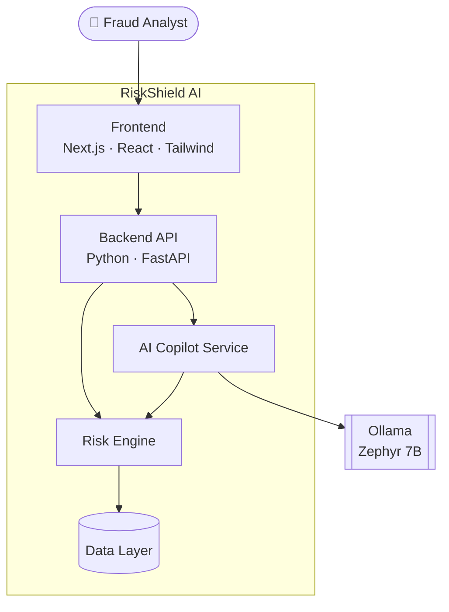

---

## 🧱 Component Overview

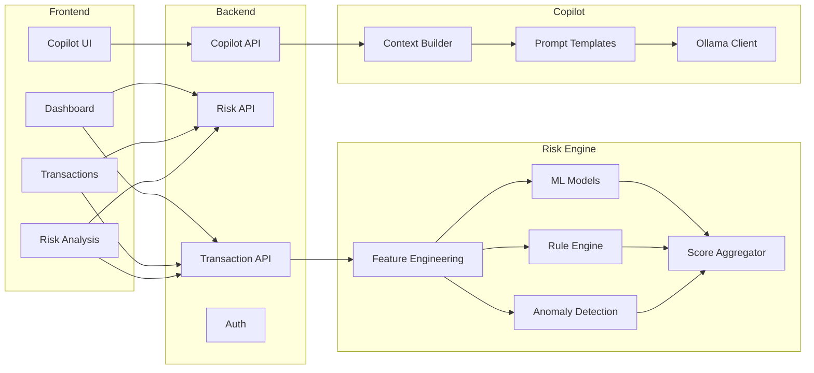

| Layer | Responsibility |
|---|---|
| **Frontend** | Dashboard, transaction views, risk analysis, Copilot chat |
| **Backend API** | Transaction, Risk, and Copilot endpoints; authentication; request validation |
| **Risk Engine** | Authoritative scoring and evidence generation |
| **Data Layer** | Transactions, datasets, history, processed features, indexes |
| **Copilot** | Context building, prompting, Ollama communication, response shaping |

---

## 🧩 Risk Engine

The Risk Engine is the **only** component that produces risk decisions.

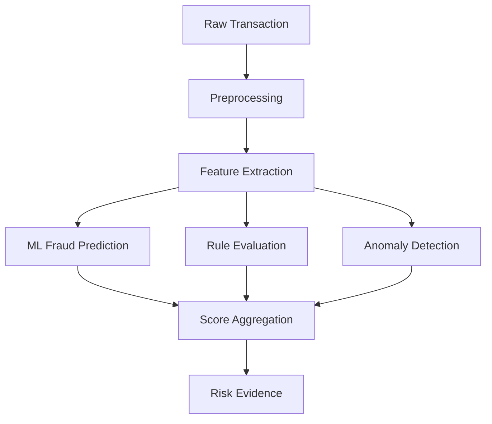

### Signals consumed

| Category | Examples |
|---|---|
| **Amount** | Amount outliers vs. history |
| **Behavior** | Frequency, velocity, user behavior patterns |
| **Context** | Device, location, geographic anomalies |
| **Temporal** | Transaction timing |
| **History** | Past activity and prior risk cases |
| **Rules** | Rule violations such as `RULE_HIGH_AMOUNT`, `RULE_NEW_DEVICE` |

### Output contract (evidence)

| Field | Description |
|---|---|
| `risk_score` | Overall score (0–100) |
| `fraud_probability` | Estimated fraud likelihood |
| `risk_level` | Low / Medium / High |
| `signals` | Risk factors with severity |
| `triggered_rules` | Rules that fired |
| `anomalies` | Detected behavioral abnormalities |
| `features` | Features used in the analysis |
| `recommended_action` | Suggested defensive response (e.g. step-up authentication) |

```json
{
  "transaction_id": "TX-102",
  "risk_score": 87,
  "risk_level": "HIGH",
  "fraud_probability": 0.87,
  "signals": [
    { "name": "unusual_amount", "severity": "high" },
    { "name": "new_device", "severity": "medium" }
  ],
  "triggered_rules": ["RULE_HIGH_AMOUNT", "RULE_NEW_DEVICE"]
}
```

---

## 🔄 End-to-End Transaction Flow

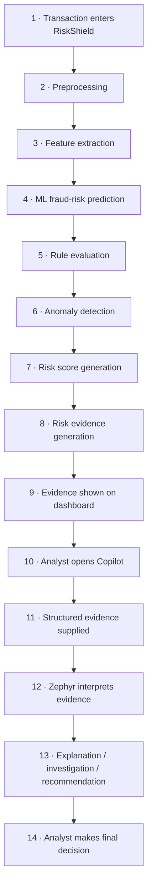

Steps 1–9 never depend on the LLM. Steps 10–13 are optional and additive.

---

## 🧠 AI Copilot

### Request flow

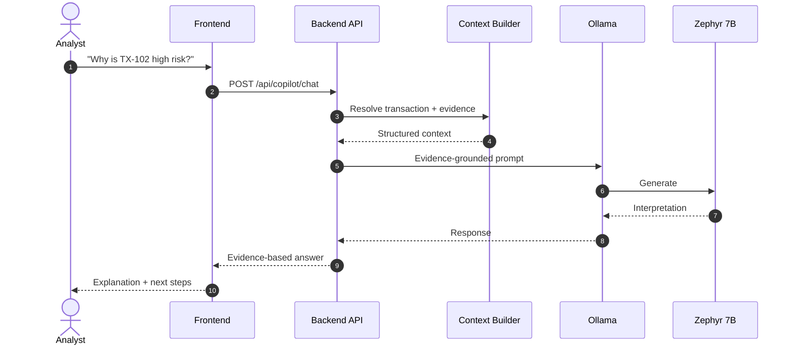

### Copilot module layout

| File | Role |
|---|---|
| `ollama_client.py` | HTTP client for Ollama, with timeouts and error handling |
| `service.py` | Orchestrates context building, prompting, response handling |
| `prompts.py` | System and task prompt templates |
| `schemas.py` | Request/response validation models |

### Supported interactions

`chat` (Q&A over a transaction) and `investigate` (guided analysis). Typical tasks include explaining risk, listing triggered rules, summarizing a transaction, and suggesting next investigative steps.

---

## 🛡️ AI Safety Boundaries

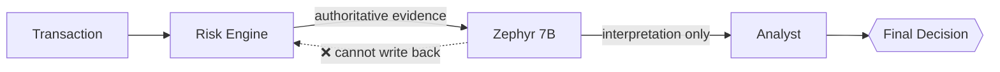

| Guardrail | Enforcement |
|---|---|
| Cannot modify risk score | Evidence is passed read-only; no write path from Copilot to engine |
| Cannot fabricate evidence | Prompt restricts answers to supplied fields; unavailable data must be stated as unavailable |
| Cannot execute arbitrary SQL | Copilot has no database tool; backend exposes only controlled lookups |
| Cannot access secrets | Secrets live in environment config and are never placed in prompts |
| Cannot approve/reject | No decision endpoint is reachable from the LLM path |
| Prompt-injection resistance | Transaction fields are treated as data, validated, and tested adversarially |

---

## 📚 Data Layer

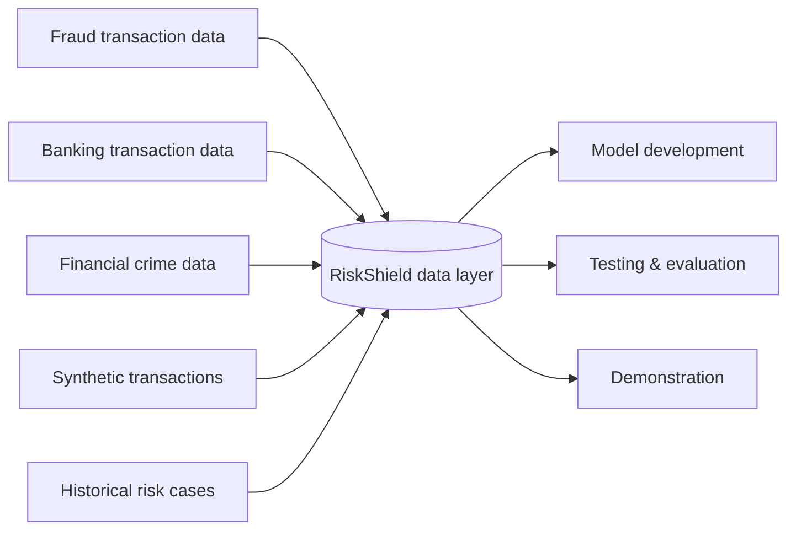

Synthetic records reproduce realistic transaction patterns without exposing real customer information. Data is organized under `data/datasets`, `data/processed`, and `data/indexes`.

---

## 🚢 Deployment Topologies

RiskShield supports four coexisting modes.

### Mode 1 · Existing local application

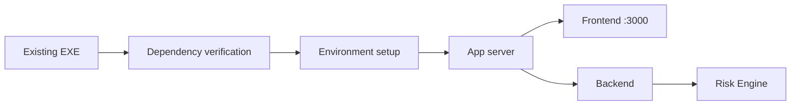

Launchers, startup scripts, datasets, APIs, and ports are preserved. Works without the Copilot.

### Mode 2 · Local AI Copilot

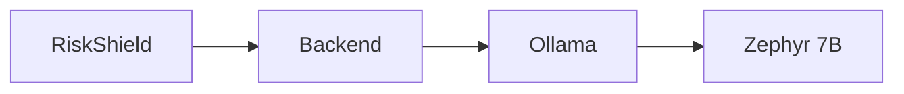

Inference runs on-device, so transaction context need not go to an external LLM service.

### Mode 3 · Docker Compose

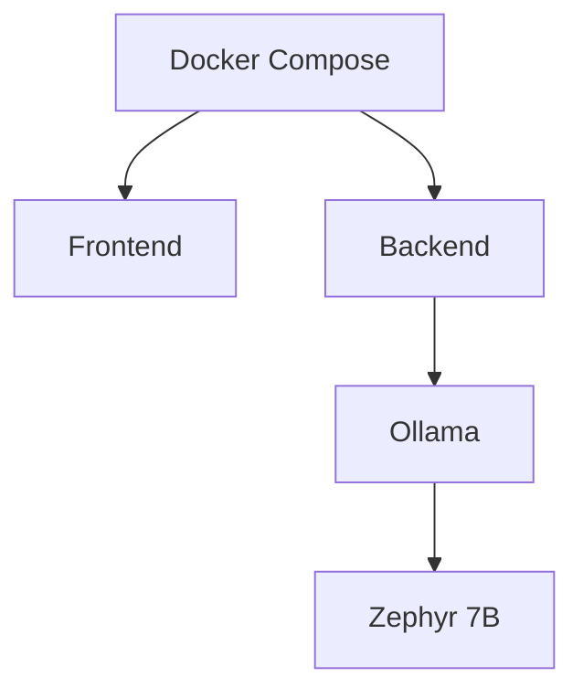

### Mode 4 · Production VPS

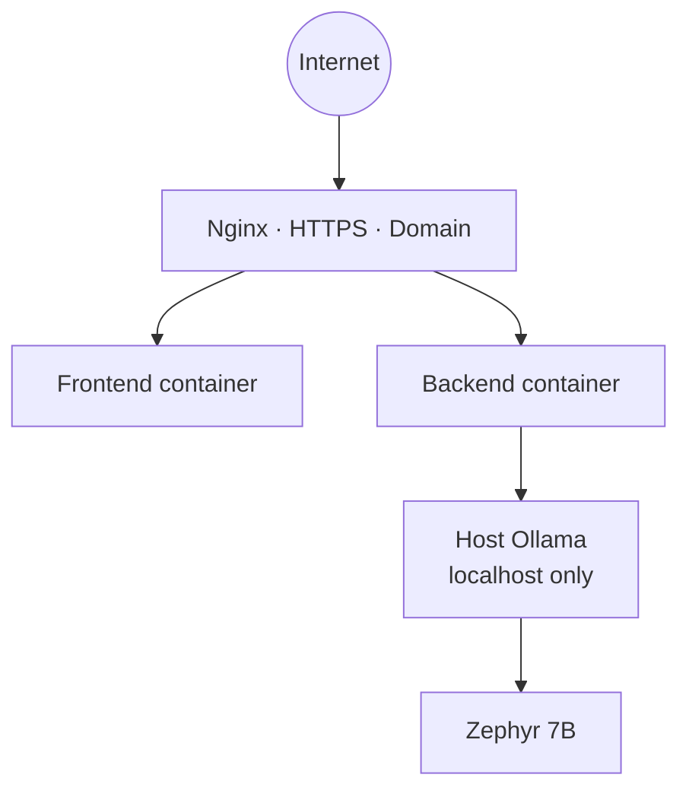

```text
Ubuntu VPS
├── Nginx            (TLS termination, reverse proxy)
├── Docker
│   ├── RiskShield Frontend
│   └── RiskShield Backend
└── Ollama           (host-level, bound to localhost)
    └── Zephyr 7B
```

> 🔒 **Ollama port `11434` must never be exposed publicly.** Bind to localhost or a private network only.

### Deploy checklist

```bash
cp .env.example .env                          # configure secrets and URLs
curl -fsSL https://ollama.com/install.sh | sh # install Ollama
ollama pull zephyr:7b-beta                    # fetch the model
docker compose build
docker compose up -d
docker compose ps
# verify: /api/health and /api/copilot/health
```

---

## 🔐 Security Architecture

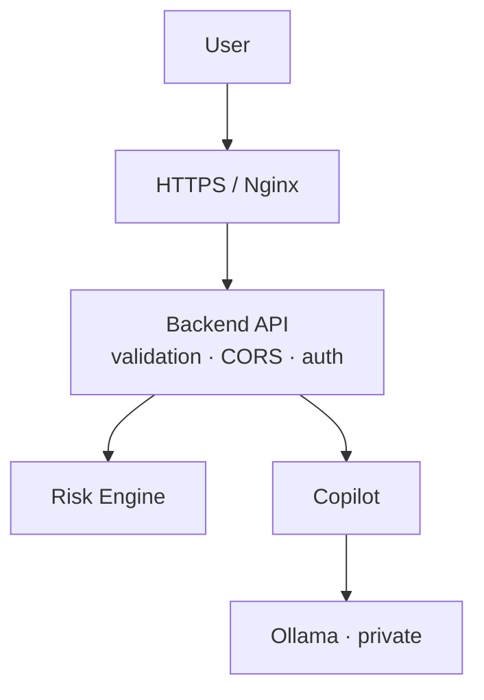

| Control | Purpose |
|---|---|
| Environment-based secrets | No credentials in code or frontend |
| Nothing secret committed to Git | `.env` ignored; `.env.example` documents keys |
| HTTPS everywhere in production | Transport security |
| Restricted CORS | Only approved frontend origins |
| Request validation | Pydantic-style schemas on all inputs |
| Controlled backend tools | No arbitrary SQL from the LLM |
| Private Ollama endpoint | No public model access |
| Safe error handling | No internal details leaked to clients |
| Optional authentication integration | Plug into existing identity systems |

---

## 🩺 Health & Failure Modes

| Scenario | Backend | Risk Engine | Ollama | Copilot |
|---|---|---|---|---|
| All healthy | 🟢 | 🟢 | 🟢 | 🟢 Available |
| Ollama stopped or model missing | 🟢 | 🟢 | 🔴 | 🔴 Unavailable |
| Slow inference or timeout | 🟢 | 🟢 | 🟡 | 🟡 Degraded, with timeout handling |

**Isolation guarantee:** LLM latency or failure cannot block or alter core risk analysis. Probe with `GET /api/health` and `GET /api/copilot/health`.

---

## ⚡ Performance & Scalability

Zephyr 7B latency depends on CPU, RAM, GPU/VRAM, quantization, concurrency, and context size. Because the Risk Engine and Copilot are logically separate, slow inference never blocks scoring.

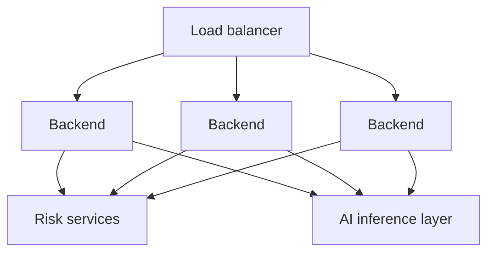

Planned scaling: stateless backend replicas, a shared risk-services tier, and a dedicated (optionally GPU-backed, distributed) inference layer.

---

## 📈 Evaluation Methodology

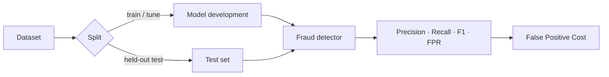

- The test set is **never** used for training or tuning.
- `False Positive Cost = False Positives × Estimated Cost per False Positive`, with the unit cost configurable to the business.
- Only results from real experiments are reported. No benchmark numbers are asserted in the documentation until they exist.

---

## 📁 Repository Layout

```text
RiskShield/
├── backend/
│   ├── app/
│   │   ├── api/
│   │   ├── copilot/        # ollama_client · service · prompts · schemas
│   │   ├── risk_engine/
│   │   ├── models/
│   │   ├── services/
│   │   └── main.py
│   ├── requirements.txt
│   └── Dockerfile
├── frontend/
│   ├── app/ · components/ · services/ · public/
│   ├── package.json
│   └── Dockerfile
├── data/                   # datasets · processed · indexes
├── scripts/
├── nginx/
├── docker-compose.yml
├── .env.example
├── DEPLOYMENT.md
├── ARCHITECTURE.md
└── README.md
```

---

<div align="center">

**The Risk Engine detects. The AI Copilot explains. The analyst decides.**

</div>
