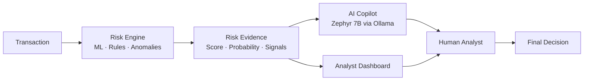
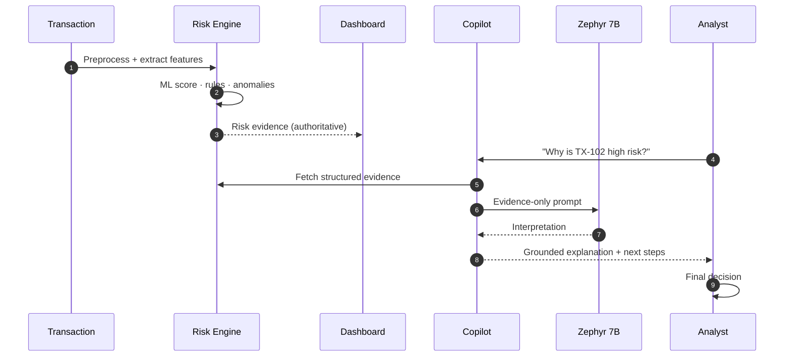

<div align="center">

# 🛡️ RiskShield AI

### AI-Powered Fraud-Risk Detection & Investigation Copilot

**Detect → Explain → Investigate → Decide**

[](https://www.python.org/)
[](https://fastapi.tiangolo.com/)
[](https://nextjs.org/)
[](https://ollama.com/)
[](https://www.docker.com/)
[](#-ai-safety-model)
[](#-project-status)

[**Demo Video**](https://drive.google.com/file/d/1Bk52ISzRWrvtl91k2djySw37CgwIS7KI/view?usp=sharing) ·
[**Download for Windows**](https://github.com/Deep455-16/NovaTrust-Banking-RiskShield-Manager/releases/latest/download/RiskShieldSetup.exe) ·
[**Architecture**](ARCHITECTURE.md) ·
[**Quick Start**](#-quick-start)

</div>

---

## 📖 Overview

**RiskShield AI** is a defensive financial-fraud platform. A deterministic **Risk Engine** (machine learning + rules + anomaly detection + behavioral signals) scores every transaction and produces structured evidence. An optional, **evidence-grounded AI Copilot** (Zephyr 7B served locally via Ollama) then explains that evidence in plain language and suggests what an analyst should examine next.

> **The Risk Engine detects. The AI Copilot explains. The analyst decides.**

The LLM is never the source of truth. It cannot change a score, invent evidence, or approve/reject a transaction.



---

## ✨ Key Features

| | Feature | What it gives you |
|---|---|---|
| 🔍 | **Multi-signal fraud detection** | ML prediction, rule evaluation, anomaly detection, velocity, device, geo, timing, and amount signals |
| 📊 | **Structured risk evidence** | Risk score, fraud probability, risk level, risk factors, triggered rules, recommended action |
| 🔎 | **Explainable by design** | Every flag ships with the *why*, not just a label |
| 🧠 | **AI Investigation Copilot** | Natural-language explanations, summaries, and next-step suggestions grounded in engine evidence |
| 🛡️ | **Defense-first safety model** | LLM is read-only over evidence; analyst remains the decision-maker |
| 💻 | **Local & private AI** | Zephyr 7B runs locally through Ollama, so transaction context does not need to leave your machine |
| 🔌 | **Graceful degradation** | If Ollama is down, the core Risk Engine keeps working |
| 🐳 | **Flexible deployment** | One-click Windows installer, local dev, Docker Compose, or production VPS behind Nginx |

### Example risk output

```text
Transaction:        TX-102
Risk Score:         87 / 100
Risk Level:         HIGH
Fraud Probability:  87%

Primary Risk Factors
  • Unusually high transaction amount
  • Previously unseen device
  • Geographic anomaly
  • Abnormal transaction frequency

Triggered Rules
  • RULE_HIGH_AMOUNT
  • RULE_NEW_DEVICE

Recommended Action: STEP-UP AUTHENTICATION
```

### Example Copilot questions

- *Why is this transaction high risk?*
- *Which rules were triggered?*
- *What are the strongest risk indicators?*
- *What evidence supports this score?*
- *Summarize this transaction.*
- *What should I investigate next?*

---

## 🚀 Quick Start

### Option 1 · Windows installer (recommended)

1. **[Download `RiskShieldSetup.exe`](https://github.com/Deep455-16/NovaTrust-Banking-RiskShield-Manager/releases/latest/download/RiskShieldSetup.exe)**
2. Run it and click **Next**. The installer sets up Python 3.11, Node.js 20 LTS, and all backend/frontend dependencies.
3. Click **Finish**. The app opens in your browser.

> ⏱️ First-time setup takes about 2–5 minutes; later launches start in under 5 seconds.
> 💡 If you already have Python 3.11 and Node.js 20 installed, installing them yourself first makes setup noticeably faster.

### Option 2 · From source

**Prerequisites**

| Tool | Version | Notes |
|---|---|---|
| Python | 3.11.x | Tick **Add Python to PATH** during install |
| Node.js | 20 LTS | |
| Git | Latest | |
| Ollama | Latest | Only needed for the AI Copilot |

```bash
git clone https://github.com/Deep455-16/NovaTrust-Banking-RiskShield-Manager.git
cd NovaTrust-Banking-RiskShield-Manager

install.bat      # installs pip + npm dependencies
start_app.bat    # launches backend + frontend
```

Open **http://127.0.0.1:3000** once both servers are ready.

### 🤖 Enable the AI Copilot (optional)

The Copilot uses a ~4 GB model that is intentionally *not* bundled, which keeps the core install light.

```bash
# 1. Install Ollama: https://ollama.com/download
# 2. Pull the model once
ollama pull zephyr:7b-beta
```

Verify with `GET /api/copilot/health`.

---

## 🧩 How It Works



For the full component breakdown, deployment topologies, and security model, see **[ARCHITECTURE.md](ARCHITECTURE.md)**.

---

## 🛡️ AI Safety Model

Zephyr is deliberately fenced off from the authoritative decision.

| The Copilot **cannot** | The Copilot **can** |
|---|---|
| ❌ Modify or override the risk score | ✅ Explain observed signals |
| ❌ Invent transaction data or evidence | ✅ Assist investigations |
| ❌ Run arbitrary SQL | ✅ Give evidence-based recommendations |
| ❌ Access application secrets | ✅ State clearly when information is unavailable |
| ❌ Approve or reject transactions | ✅ Keep the human analyst in the loop |

---

## 📈 Evaluation

RiskShield is designed around **measurable** fraud-detection performance, evaluated on a **held-out test set** never used for training or tuning.

| Metric | Meaning |
|---|---|
| **Precision** | Share of flagged transactions that are truly fraud |
| **Recall** | Share of all fraud that was caught |
| **F1** | Balance of precision and recall |
| **False Positive Rate** | Share of legitimate transactions wrongly flagged |
| **False Positive Cost** | `False Positives × Estimated Cost per False Positive` (configurable) |

> **Note:** No benchmark numbers are claimed here. Results will be published only from real held-out experiments. See [Project Status](#-project-status).

---

## 🔌 API

| Method | Endpoint | Purpose |
|---|---|---|
| `GET` | `/api/health` | Backend and Risk Engine health |
| `GET` | `/api/copilot/health` | Ollama / model availability |
| `POST` | `/api/copilot/chat` | Ask the Copilot about a transaction |
| `POST` | `/api/copilot/investigate` | Run a guided investigation |

> Exact endpoints follow the project's current API conventions.

<details>
<summary><b>Example risk-engine payload</b></summary>

```json
{
  "transaction_id": "TX-102",
  "risk_score": 87,
  "risk_level": "HIGH",
  "fraud_probability": 0.87,
  "signals": [
    { "name": "unusual_amount", "severity": "high" },
    { "name": "new_device", "severity": "medium" }
  ],
  "triggered_rules": ["RULE_HIGH_AMOUNT", "RULE_NEW_DEVICE"]
}
```

</details>

---

## 🛠️ Technology Stack

| Layer | Technology |
|---|---|
| **Frontend** | Next.js, React, Tailwind CSS |
| **Backend** | Python, FastAPI, Uvicorn |
| **Risk Engine** | Machine learning, feature engineering, rule-based detection, anomaly detection |
| **AI Copilot** | Zephyr 7B (`HuggingFaceH4/zephyr-7b-beta`) served by Ollama |
| **Data** | Banking, fraud, and synthetic financial datasets |
| **Infrastructure** | Docker, Docker Compose, Nginx, Ubuntu VPS, HTTPS |

---

## 🚢 Deployment Modes

| Mode | Description | Best for |
|---|---|---|
| **1 · Local app** | Windows installer / `start_app.bat`, Risk Engine only | Demos, offline use |
| **2 · Local + Copilot** | Backend + local Ollama + Zephyr | Private AI-assisted investigation |
| **3 · Docker** | Frontend + Backend containers (+ Ollama) | Reproducible environments |
| **4 · Production VPS** | Nginx/HTTPS → Docker app → host Ollama | Public deployment |

```bash
cp .env.example .env
docker compose build
docker compose up -d
docker compose ps
```

> 🔒 **Never expose Ollama's port `11434` publicly.** Details in [ARCHITECTURE.md](ARCHITECTURE.md#-deployment-topologies).

### Configuration

| Variable | Purpose |
|---|---|
| `APP_ENV` | Application environment |
| `BACKEND_HOST` / `BACKEND_PORT` | Backend bind address and port |
| `OLLAMA_BASE_URL` | Ollama server address |
| `OLLAMA_MODEL` | AI model name |
| `CORS_ORIGINS` | Allowed frontend origins |
| `SECRET_KEY` | Application security secret |
| `DATABASE_URL` | Database connection (if supported by your deployment) |

---

## 📁 Project Structure

```text
RiskShield/
├── backend/
│   ├── app/
│   │   ├── api/             # REST routes
│   │   ├── copilot/         # ollama_client · service · prompts · schemas
│   │   ├── risk_engine/     # scoring, rules, anomalies
│   │   ├── models/
│   │   ├── services/
│   │   └── main.py
│   ├── requirements.txt
│   └── Dockerfile
├── frontend/                # Next.js dashboard + Copilot UI
├── data/                    # datasets · processed · indexes
├── scripts/
├── nginx/
├── docker-compose.yml
├── .env.example
├── ARCHITECTURE.md
├── DEPLOYMENT.md
└── README.md
```

---

## 🧪 Testing

| Area | Coverage |
|---|---|
| **Risk Engine** | Preprocessing, feature extraction, scoring, probability, rules, anomalies |
| **Detector evaluation** | Precision, recall, F1, FPR, false-positive cost on held-out data |
| **Copilot** | Valid questions, missing evidence, invalid IDs, Ollama/model down, timeouts, large context |
| **Security** | Secret isolation, input validation, CORS, SQL-execution prevention, prompt-injection resistance |
| **Deployment** | `docker compose config` → `build` → `up` |

---

## 🩺 Troubleshooting

```bash
ollama list                    # is Zephyr installed?
ollama pull zephyr:7b-beta     # download the model
docker compose ps              # service status
docker compose logs -f         # live logs
```

If Ollama is unavailable, the Copilot reports **UNAVAILABLE** while the Backend and Risk Engine stay **HEALTHY**.

---

## 📌 Project Status

| Component | Status |
|---|---|
| Core risk management | 🟢 Active |
| Fraud-risk detection | 🟢 Active |
| Risk evidence generation | 🟢 Active |
| AI Copilot (Ollama + Zephyr) | 🟢 Integrated |
| Windows installer | 🟢 Available |
| Docker / VPS deployment | 🟢 Supported |
| Evaluation framework | 🟡 Metrics to be populated from real held-out results |

---

## 🔮 Roadmap

- [ ] Publish held-out evaluation results (precision / recall / F1 / FP cost)
- [ ] Real-time transaction streaming
- [ ] Graph-based fraud and entity-relationship analysis
- [ ] Account-takeover detection
- [ ] Historical case retrieval (RAG) and analyst feedback loops
- [ ] Model monitoring and drift detection
- [ ] Audit trails and enterprise authentication
- [ ] Case management and automated investigation workflows
- [ ] GPU acceleration and distributed inference

---

## 🤝 Contributing

```bash
git checkout -b feature/<feature-name>
git commit -m "Add <feature>"
git push origin feature/<feature-name>
```

Open a pull request describing **what** changed, **why**, the **testing and evaluation** performed, and any **deployment implications**.

---

## ⚠️ Disclaimer

RiskShield AI is an analytical and decision-support system. Its risk assessments and AI-generated explanations must be reviewed by qualified analysts and are not an unconditional determination of fraud. The Copilot reasons only over evidence supplied by the system and does not replace financial, legal, compliance, or security procedures.

---

<div align="center">

**🛡️ RiskShield AI: Detect. Explain. Investigate. Decide.**

Built by [Deep455-16](https://github.com/Deep455-16)

</div>
